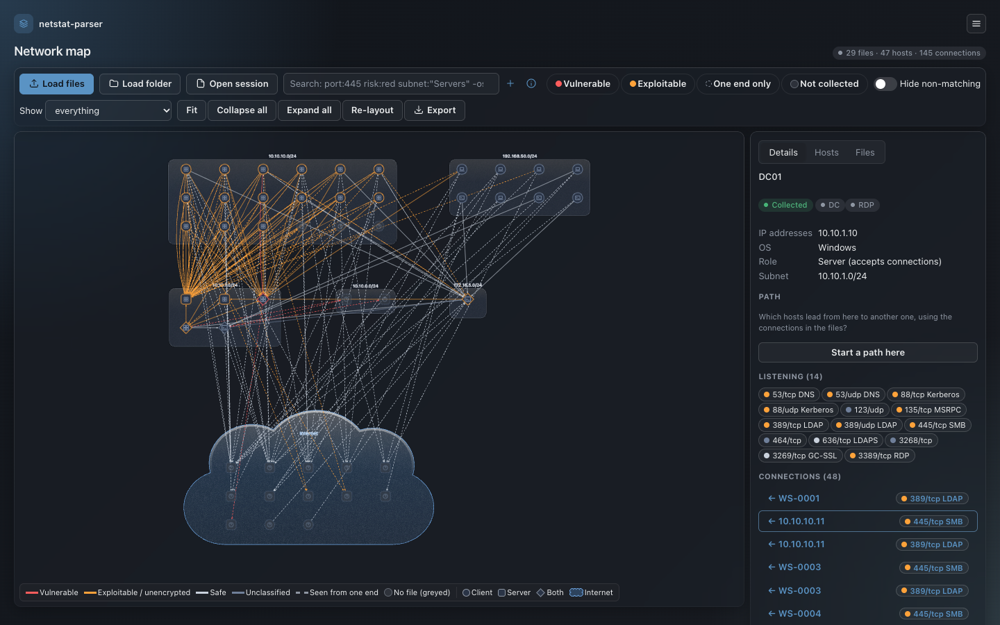
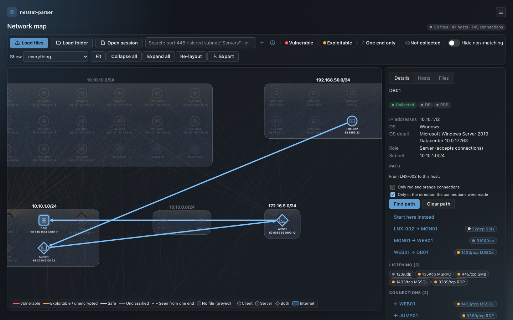
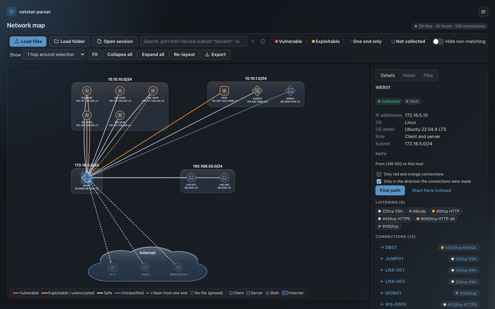
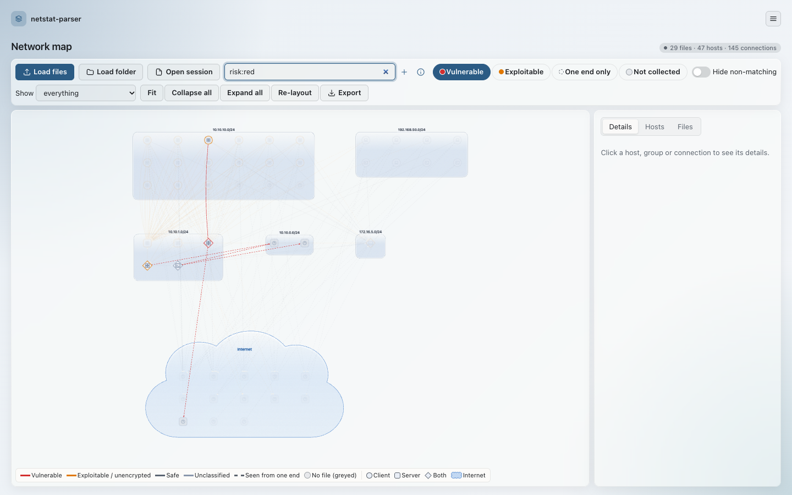
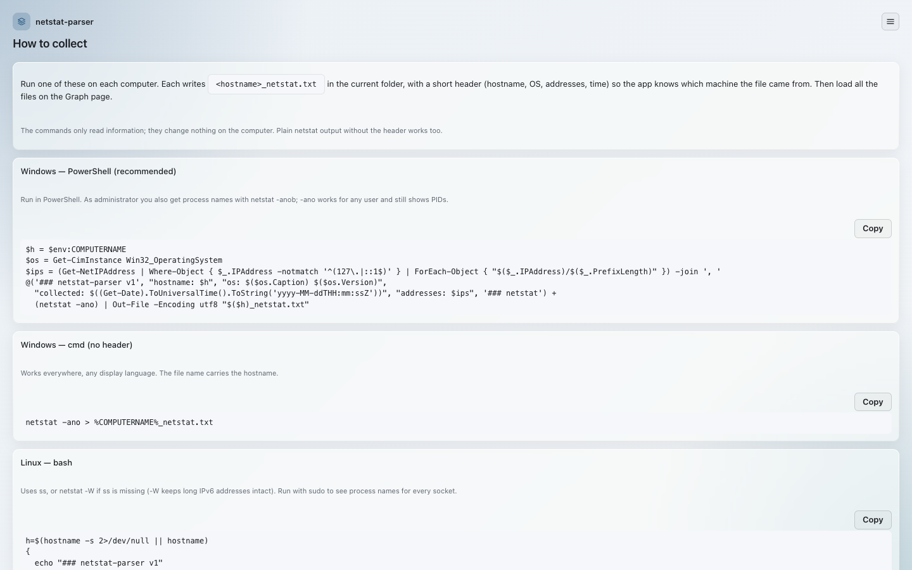
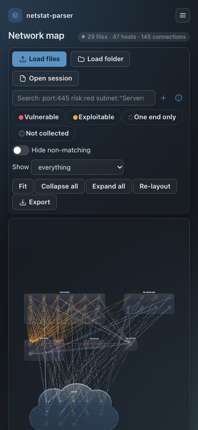

# netstat-parser

Turn netstat output from many Windows, Linux and macOS machines into one interactive network map:
who talks to whom, over which protocols, and where the risky ones are. Built for pentesters and
incident responders mapping a network they have been given access to.

Everything runs locally in your browser. Files are never uploaded, and the app makes no network
requests unless you switch on the optional DNS lookup.

<table>
  <tr>
    <td width="33%"><br>Network map: subnets, the Internet cloud and risk-coloured connections; a selected host's details on the right.</td>
    <td width="33%"><br>Path finding: the shortest chain of observed connections from one host to another.</td>
    <td width="33%"><br>Neighbourhood view: only what is one hop around the selected web server.</td>
  </tr>
  <tr>
    <td width="33%"><br>Light theme with the <b>Vulnerable</b> quick filter (<code>risk:red</code>).</td>
    <td width="33%"><br>How to collect: copy-ready, read-only commands per OS.</td>
    <td width="33%"><br>On a phone: the toolbar wraps, nothing scrolls sideways.</td>
  </tr>
</table>

All screenshots use the synthetic test networks (`npm run gen:data`), never real data.

**Version 0.2.0** (2026-11-11), the first public release. The web app and the collector script are
usable; the collector's WinRM path and the collect commands have not yet been tried on real
Windows and Linux machines. Design: [docs/superpowers/specs/2026-11-10-netstat-parser-design.md](docs/superpowers/specs/2026-11-10-netstat-parser-design.md).
The version is shown in the menu (top right) and by `python3 collector/collect.py --version`.

## What's new in 0.2.0

- **Analysis:** `process:` search, saved filters as chips, path finding between hosts, and a
  neighbourhood view (1 or 2 hops around the selection).
- **DNS:** a Resolve name button per Internet host and an optional automatic lookup after
  loading; nodes no longer move when names arrive.
- **Loading:** whole folders and `.zip` files; adding files asks whether to merge or start a new
  job; the current job survives a reload (kept in this browser, can be turned off).
- **Collector:** `collector/collect.py` gathers the files over SSH or WinRM.
- **Look:** subnet groups and the Internet cloud as frosted glass; a top-right menu instead of the
  sidebar.

Older changes: [CHANGELOG.md](CHANGELOG.md).

## Features

- **Load many files at once** (up to ~1000): Windows `netstat -ano` (English, Swedish and German
  output), Linux `netstat` and `ss`, and macOS `netstat`. The format is detected automatically,
  and both IPv4 and IPv6 are handled.
- **Network graph:** hosts are grouped by subnet, and public addresses go into an "Internet" cloud.
  Subnets with up to 30 hosts start expanded and larger ones collapsed (the number is a setting).
- **Risk colours:** red for vulnerable protocols (e.g. Telnet, FTP), orange for exploitable or
  unencrypted ones (e.g. SMB, RDP, HTTP), neutral for safe ones (e.g. SSH, HTTPS).
- **Coverage at a glance:**
  - solid line: the connection was seen from both ends
  - dashed line: seen from one end only
  - greyed-out host: appears in other machines' files but has no file of its own
- **Hosts:** the node shape shows the role (client, server or both) and an icon shows the OS.
  Badges show listening ports, and tags mark well-known roles such as DC, DB, Web and RDP.
- **Details panel** for any host, group, cloud or connection.
- **Search and filter**, e.g. `port:445 subnet:"Office VLAN" risk:red` or `process:sshd` (files
  with process names: Windows `netstat -anob`, Linux `ss -tunap`). Save any search as a named
  chip next to the quick filters (the **+** beside the search box).
- **Path finding:** in a host's details choose **Start a path here**, select another host and
  choose **Find path**: the shortest chain of observed connections from one to the other, by
  default only in the direction they were made, optionally only over red and orange connections.
- **Neighbourhood view:** **Show → 1 hop / 2 hops around selection** draws only what is near the
  selected host, group or line; click a neighbour to walk the network.
- **Settings:** edit which protocols count as vulnerable, unencrypted or safe; name your subnets;
  edit the role rules.
- **Optional DNS lookup** for Internet addresses via DNS-over-HTTPS (Cloudflare, Google or Quad9),
  off by default. Once enabled in Settings: **Resolve DNS** looks up every Internet host, the
  **Resolve name** button in an Internet host's details looks up just that one, and an optional
  setting does it automatically after loading. Until you tick "I understand that public IP
  addresses are sent", every lookup asks first. Internal and documentation addresses are never sent.
- **Survives a reload:** the current job (files, layout, DNS names, expanded groups) is kept in
  this browser until you start a new job. Turn it off in Settings → "Keep the current job in this
  browser" (this also deletes the kept copy). Nothing is uploaded.
- **Dark and light themes:** follows your system, or pick Dark or Light in the menu (top right).
- **Exports:**
  - PNG
  - a saved session (`.json`) you can reopen later
  - CSVs of connections (with the process seen at each end) and hosts
  - a targets file listing uncollected hosts, for the collector
- **"How to collect" page** with copy-ready commands per OS. Each command writes
  `<hostname>_netstat.txt` with a short header (hostname, IPs, OS, time).
- **Collector script** (`collector/`, Python 3): gathers the same files remotely over SSH (keys
  or ssh-agent) or WinRM (password from an environment variable or a prompt) and saves them on
  your machine. It only runs read-only commands and has a dry-run mode. See
  [collector/README.md](collector/README.md).

Job data is only kept in sessions you export yourself. The app does not auto-save it in the browser.

## Getting started

```sh
python3 -m http.server 8580      # then open http://localhost:8580/ (or: claude-update)
```

1. On each computer, run the command for its OS from the app's **How to collect** page. It writes
   `<hostname>_netstat.txt`.
2. Open the app and drop the files on the graph, or a whole folder, or a `.zip` of them (or use
   **Load files** / **Load folder**). From folders and zips only likely netstat files are read
   (`.txt`, `.log`, `.out`, no extension); the rest is skipped and counted. Loading more files later
   asks whether to add them to the current job or start a new one (the default is a setting).
3. Click hosts, groups or lines for details; search with `port:445 risk:red`, `collected:no`,
   `seen:one` and so on; name your subnets and tune the protocol risk table in **Settings**.
4. **Export → Session** saves the job to reopen later (nothing is saved automatically).

Many machines at once: export **Collector targets** from the graph, fill in users, then run
`python3 collector/collect.py targets.txt --dry-run` and without `--dry-run` to collect.

Try it without real data: `npm run gen:data` writes synthetic networks to `tests/data/generated/`.

## Tests

```sh
npm test            # node --test: tests/*.test.mjs
npm run lint        # ESLint, including the unsafe-DOM rule
```

The test data is synthetic: a seeded generator builds small (20–40), medium (150–250) and large
(300–400) computer networks. Its Internet addresses are well-known public services (GitHub,
Google, Cloudflare, Quad9 and others) that have reverse DNS names, so **Resolve DNS** finds names
on the demo data. Real client data is never committed, and `.gitignore` keeps
`*_netstat.txt`, targets files, sessions and exports out of git.

## License

MIT. See [LICENSE](LICENSE).
